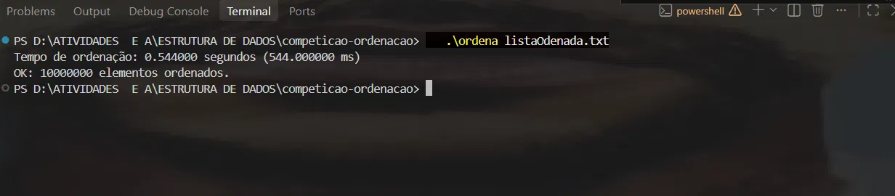

# Competição de Ordenação em C

## Algoritmo
Merge Sort (O(n log n)): divide o vetor ao meio, ordena cada metade
recursivamente e intercala as duas partes já ordenadas. Usa um vetor
auxiliar alocado uma única vez.

## Como compilar e executar
```
gcc -O3 -march=native -o ordena ordena.c
./ordena listaOdenada.txt
```
O arquivo `listaOdenada.txt` deve estar na mesma pasta (não está no
repositório por causa do tamanho).

## Medição de tempo
Usa `clock()` apenas ao redor da chamada de `merge_sort`, ignorando a
leitura do arquivo. Após a ordenação, o programa verifica se o vetor
está em ordem crescente.

## Resultado


## Equipe
1. Victor Hugo Mota Alcantara
2. Jayane Lima Fernandes
3. Kevin Soares de Oliveira
